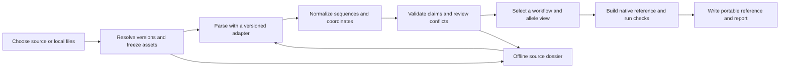

# Reproducible reference curation pipeline design

Design proposed on 2026-10-21 against
`9fbbd6ff5f38ae176aeb2c27e73ce4342afd39c7` on
`fix/biological-metadata-correctness`. This is a design, not an implemented
reference release. API names below are proposed. Research probes inspect
upstream data; they do not modify GenAIRR's bundled references.

GenAIRR should let a user select a published germline catalogue, combine
explicitly compatible sources, or supply their own sequences and annotations.
It should produce a portable reference with exact sequence identities,
traceable annotations, explicit uncertainties and a reproducible build recipe.
The same reference must load offline and support the workflows for which its
evidence and the engine are adequate.

All import, coordinate conversion, validation, curation, packaging and
simulation remain inside GenAIRR. Remote services supply data only. No IGoR,
IgBLAST, MiXCR, receptor-utils executable, external annotation service or new
runtime dependency is required. Reading another project's format documentation
or producer code during research does not introduce that project as a dependency.

## 1. Decisions

1. Use a source-neutral internal catalogue and explicit source/version adapters.
   Use rich OGRDB JSON for the first human IG pilot and compare the pinned
   `airr_ex` and `airr` representations. Establish extension, duplicate and
   paralog handling from their contents; endpoint names do not guarantee those
   properties. Support IMGT exports, annotated INSDC records and local FASTA
   with an annotation sidecar.
2. Keep source records, normalized biological entities, annotation claims,
   curation decisions and the selected execution view separate.
3. Track evidence per claim. A file checksum, a familiar database name, a
   canonical motif and a successful simulation establish different things.
4. Normalize executable sequences to ungapped DNA in the allele's coding-strand
   orientation. Preserve physical coding-end bases, partiality and source maps.
5. Make a bounded, non-executable JSON reference artifact the public exchange
   format. Keep current DataConfig/builtin APIs compatible; do not distribute
   new community references as Python pickles.
6. Separate reference evidence from empirical simulation models. Unfitted
   defaults have explicit supports and weights; they do not establish missing
   germline bases, phase, boundaries or donor genotype.
7. Freeze every source input and decision before building. Rebuilding is offline;
   updating sources is a separate, explicit operation that produces a diff.
8. Certify a declared workflow and scope. Do not assign an unqualified
   "biologically correct" Boolean to an entire database.

## 2. Current foundation and changes required

The existing audit reports 106 bundled cartridges: 80 have strict validation
findings; 26 pass structural checks but lack independent source/phase/boundary
certification. Findings can include valid biological pseudogenes or ORFs that
are unsuitable for the default productive policy. They do not imply that every
flagged sequence is erroneous. See the
[current evidence contract](../site_docs/cartridges/reference-evidence.md) and
[audit registry](../src/GenAIRR/data/reference_audit_v1.json).

| Existing component | Reuse and required improvement |
| --- | --- |
| [ReferenceCartridgeBuilder](../src/GenAIRR/cartridge_builder.py) | Preserve its public FASTA API; add a normalized-record entry point that does not lose rich annotations by converting through FASTA. |
| [Native evidence v1](../engine_rs/src/refdata/evidence.rs) | Preserve sequence binding, phase and boundary semantics; add a separate typed curation context and conservative projection from richer claims. Existing `verified` values remain author claims. |
| [DataConfig bridge](../src/GenAIRR/_refdata_resolver.py) | Fix undeclared subregion inference; carry reference context and model defaults through `Experiment.on`. |
| [Native reference validation](../engine_rs/src/refdata/validation.rs) | Reuse structural checks; add capability admission without weakening fatal checks. |
| [PyO3 reference bridge](../engine_rs/src/python/refdata.rs) | Check sequence lengths before `seq.len() as u16` is used as the V-subregion bound; this narrowing occurs in the Python bridge, not the core validator. |
| [Durable reference codec](../engine_rs/src/family_replay/reference.rs) | Reuse ordered-pool and closed-codec invariants, with compatibility tests; do not make a family replay file the reference interchange format. |
| [IMGT build script](../tools/build_imgt_configs.py) | Replace mutable-download/cache assumptions with source locks, verified blobs and distinct absence/network-error results. |
| [DataConfig checksum](../src/GenAIRR/dataconfig/data_config.py) | Preserve old semantics. Its excluded `build_report` is not an evidence commitment for a newly certified artifact. |

Three existing defects should be fixed in a standalone C0 change before the
new catalogue implementation:

- The builder can correctly leave bare FASTA subregions unknown while
  `_resolve_v_subregions()` subsequently derives fixed IMGT intervals from any
  nonempty `gapped_seq`. A read-only reproduction with an ordinary 315-nt V
  sequence produced FWR1 `[0,78)`, CDR1 `[78,114)`, FWR2 `[114,165)`, CDR2
  `[165,195)` and FWR3 `[195,312)` despite no declared numbering alignment.
  Require a declared coordinate scheme and verified mapping at every entry path.
- `infer_identity()` overwrites per-allele source/species/locus and stamps
  `date.today()`; `build()` separately stamps `date.today()` when identity has
  not been set. Separate source provenance from build identity, validate
  disagreements, and apply fixed build metadata to both authoring paths.
- Native anchors/subregions use bounded integer coordinates. Check lengths and
  coordinates before conversion; remove unchecked narrowing such as casting
  sequence length to `u16` in PyO3 `add_v_allele` before `parse_subregions`.
  The core validator is a separate layer and uses `u32` length comparisons.

These are scoped reference improvements; this project does not redesign the
mutation or repair sampling laws.

## 3. Trusted sources and what they actually provide

Trust applies to a particular claim and version, not to every field from a site.
Published data can contain inference, partial sequences or annotation defects.
Use primary-source records, retain attribution and distinguish mirrors from
independent evidence.

| Source | Preferred input and role | Adapter obligations |
| --- | --- | --- |
| OGRDB / AIRR Community | Explicit-version rich JSON, retaining both `airr_ex` and `airr` in the pilot | Preserve endpoint labels as provider declarations. Inspect actual sequences, evidence, extensions, duplicated content and paralog relationships with a tested producer profile. |
| IMGT/GENE-DB and reference directories | Documented V/D/J-region FASTA, complete headers, release identity and associated feature annotations | Preserve numbering declarations, F/ORF/P qualifiers, partiality and additions/removals; never treat every export as the same biological region. |
| GenBank/ENA through INSDC | Accession.version plus annotated GenBank/EMBL records, or pinned assembly and feature files | Extract explicitly supported features with strand and location semantics; retain evidence for boundaries, RSS, leader and genomic context. |
| NCBI germline collections and associated annotation data | Pinned sequence and matching annotation assets | Record original sources/mirrors; preserve padding/partiality and require exact sequence agreement before importing auxiliary coordinates. |
| User/laboratory files | FASTA plus GenAIRR JSON sidecar, or supported AIRR germline JSON | Accept local identifiers and private provenance; expose missing claims; allow synthetic references with explicit synthetic status. |
| VDJbase and study-specific genotype evidence | Optional pinned donor/haplotype assertions with sequence-linked provenance | Treat as a separate genotype evidence layer, not a universal catalogue or population-frequency prior. |

OGRDB's formats page describes analysis-oriented sets as deduplicated and
potentially extended, and Source sets as retaining duplicates without those
extensions. Its API labels `_ex` formats as Source. The pinned IGL v4 payloads
do not uphold that distinction: `airr_ex` lacks an explicit paralog record and
contains a coding extension that disagrees with its own sequence context,
whereas `airr` includes the record and cuts coding sequences to declared
intervals. Some of those intervals themselves conflict with the record's RSS
context. Neither endpoint is an automatic authority for coding ends. Capture
both variants, retain their differences, and review record-level support.
[Formats](https://wordpress.vdjbase.org/index.php/ogrdb/explanation-of-germline-set-formats/),
[API guide](https://raw.githubusercontent.com/airr-community/ogrdb/master/schema/ogrdb_api_v2_guide.md).

This is a discrepancy between the documented distinction and the observed
release, not proof that endpoint semantics are globally reversed. Ask the
maintainers whether release payload generation, historic record annotations
or the documentation explains it before codifying a general interpretation.
The evidence package should contain the exact URLs, hashes, fields and
examples needed for that clarification.

There is also a provider label inside the payload: all 97 `airr_ex`
`allele_description_ref` values end in `_ext`, while none of the 98 `airr`
values do. Retain this observed suffix and the exact identifiers in the probe
and any maintainer question. It is relevant to the endpoint/documentation
discrepancy, but its meaning must not be guessed into a biological annotation
or used to replace record-level evidence checks.

IMGT supplies several distinct export types, including coding regions,
artificially spliced sequences and gapped alignments. Its documented coding
strand is not necessarily the genomic plus strand. A J sequence derived from
cDNA may have a terminal base restored in the reference export; retain that
transformation and its support rather than reconstructing it again.
[Reference directory](https://www.imgt.org/vquest/refseqh.html),
[GENE-DB format documentation](https://www.imgt.org/genedb/doc).

INSDC feature labels also require interpretation: `V_region` can describe an
assembled variable region, whereas `V_segment` can include leader-derived
bases. Neither is automatically an IMGT V-REGION. ENA provides annotated EMBL
records as well as FASTA; FASTA alone discards much of the needed evidence.
[Feature table](https://www.insdc.org/submitting-standards/feature-table/),
[ENA retrieval](https://ena-docs.readthedocs.io/en/latest/retrieval/programmatic-access/browser-api.html).

NCBI explicitly documents end padding in its mouse collection. Its IgBLAST
documentation also requires auxiliary J annotations to match the actual
sequence database. Importing those data, if selected, requires no invocation
of IgBLAST and supplies no independent second vote when the underlying records
come from OGRDB or IMGT.
[Collection notes](https://www.ncbi.nlm.nih.gov/projects/igblast/showGermline.cgi),
[Annotation compatibility](https://ncbi.github.io/igblast/cook/How-to-set-up.html).

VDJbase exposes separate repertoire and genomic interfaces, including genotype
exports. A later connector must retain dataset, subject/sample scope and
inference provenance rather than treating repertoire-derived genotypes as
complete genomic observations.
[VDJbase API documentation](https://wordpress.vdjbase.org/index.php/vdjbase_help/using-the-vdjbase-rest-api/).

### Source rights and retrieval

Record data-license identifier, exact terms URL and retrieval snapshot,
attribution, source citation and redistribution status separately from software
license. As consulted on 2026-10-21, OGRDB states CC0 for site content, and
IMGT's current terms state CC BY 4.0 for data and metadata. This is not a claim
about every historical or third-party derivative. The sampled OGRDB API `Info`
object describes the API and its software license; do not reinterpret it as
the data's license or assume its version is the AIRR schema version.
[OGRDB licensing](https://ogrdb.airr-community.org/render_page/licensing_statement.html),
[IMGT terms](https://www.imgt.org/about/termsofuse.php).

Use documented download endpoints with bounded requests and caching. If an
asset needs an authorized manual download, accept that exact local asset with
its digest and provenance. Do not make scraping protected pages a prerequisite
for custom references. Local-only references require no network access or upload.

## 4. Live research findings that shape the adapter design

The accompanying [source probe](reference_curation_source_probe_2026_10_21.json)
and [research script](../tools/metadata_biology_audit/reference_source_probe.py)
record a small, version-pinned comparison of human IGL v4. This is a format and
consistency investigation, not a biological certification of the set.

- The payload labelled Source (`airr_ex`) contains 97 records; `airr` contains
  98. The six `coding_sequence` versus `sequence[gene_start - 1:gene_end]`
  disagreements divide into two different finding classes, described below.
  They are not six equivalent inferred extensions.
- All nine Source J records use `j_cdr3_end` as a one-based coordinate in
  `coding_sequence`. In IGLJ7*02, value 8 identifies TTC at coding index 7;
  full-sequence index 7 is GTG. `j_codon_frame=2` agrees with codon-start offset
  1 in that coding sequence.
- The AIRR 2.0 germline prose instead locates `j_cdr3_end` in `sequence`, and
  describes `j_codon_frame` as the codon position of the first nucleotide.
  Those definitions require different conversion formulas.

### Two distinct coding-end findings

| Observed class | Records | Internal evidence and required response |
| --- | --- | --- |
| `coding_end_before_declared_v_rss` | IGLV10-54*04, IGLV2-14*03, IGLV3-21*04, IGLV3-25*03, IGLV6-57*04 | Each coding sequence is the declared slice plus two bases present immediately afterward in the same record; it equals extraction through the base preceding `v_rs_start`. Preserve an endpoint conflict and a candidate extension of `gene_end`, subject to curation. |
| `coding_extension_disagrees_with_record_context` | IGLV3-9*01 | The coding sequence adds `CACCC`, but the corresponding record context is `CACAG` at its declared RSS. It is tagged `likely_truncated`. Preserve an unsupported-by-this-context extension finding; do not certify the added bases as original coding-end DNA. |

In the five two-base cases, `v_rs_start - gene_end = 3` under the tested
one-based closed convention. The candidate complete end is
`v_rs_start - 1`, two bases beyond the declared `gene_end`. Of all 88 V records,
82 have `v_rs_start - gene_end = 1`, five have 3 and one lacks an RSS start.
Missing RSS is a distinct unknown, not an ordinary zero-gap case.

Sibling alleles of the same gene share the relevant terminal two bases in the
sampled records. The probe reports those comparisons and the embedded support
of each sibling separately; longer tails are not uniformly identical and some
siblings are inferred without embedded unrearranged support. These comparisons
are internal corroboration, not an independent genomic observation.

Historical curation notes also matter. All five records describe older IARC
inference limits that did not affirm their last two 3′ bases, and all five
contain genomic support entries. A declared affirmed span and a complete
recombination substrate are different claims. The current combination of
coding sequence, endpoint, RSS context and historic notes supports a reviewable
annotation conflict, not a universally established correction. Curators should
inspect the exact source sequence/feature coordinates, historic affirmed span,
RSS annotation, sibling support and accession-versioned genomic evidence.
Independent retrieval/revalidation is needed before a strong boundary claim;
the repeated assertions within one provider do not supply independence.

The historical affirmed nucleotide counts use IMGT-gapped numbering; a count
such as 339 cannot be applied as a direct index into a 296-nt coding sequence.
Both payloads contain 88 V records, and all 88 `aligned_sequence` fields in
their V delineations are null in each variant: usable coverage is 0/88 for
both. These JSON files alone cannot reconstruct or validate the numbered
affirmed-span mapping. C2 must acquire a pinned matching gapped asset and
validate its sequence identity and numbering convention under mapping rule 3
before projecting those spans. Until then, retain the original statement and
its coordinate-space qualification with an unresolved mapping.

In `airr`, all six coding sequences equal their declared intervals. For the
five two-base cases this also removes bases that the other record fields
support as candidate coding-end bases. A zero mismatch count therefore does
not establish physical coding-end correctness. Neither field silently wins,
and neither endpoint is globally preferred.

### Paralog identity accounting

`airr_ex` names IGLJ3*01 only in IGLJ2*01's `paralogs` relationship. `airr`
contains an explicit IGLJ3*01 record with identical sequence bytes. Reading
only the Source record array would omit a named gene identity. The importer
must inventory both explicit records and entities mentioned in typed identity
relationships, including whether each reference resolves inside the payload
or a separately pinned source.

Keep record counts, mentioned-entity counts, represented biological identities
and executable allele counts separate. A paralog is not an allele alias, and
a named relationship is not automatically a fully evidenced sequence record.
Create an unresolved entity/reference when necessary; assign a sequence or
admit it for sampling only through an explicit supported mapping. Do not
silently drop the identity, invent a full record or merge its gene into the
record whose sequence matches. Report `paralog_named_without_own_record` and
the cross-variant relationship with their evidence lineage.

In this example the explicit `airr` IGLJ3*01 record has its own supporting
record information, distinct from IGLJ2*01. Preserve that evidence separately;
do not create J3 by cloning J2's accession, genomic coordinates or donor
assertions. Likewise, `CACCC` appearing elsewhere in the IGLV3-9*01 source
sequence would not support its placement at the coding end: the test concerns
the specific adjacent sequence and mapped interval.

The sampled producer conventions are also consistent with the linked,
commit-pinned producer utility. That code is corroborating format evidence,
not a dependency or proof of biochemical correctness.
[Sampled Source JSON](https://ogrdb.airr-community.org/api_v2/germline/set/9606.IGLambda_VJ/4/airr_ex),
[AIRR germline definitions](https://docs.airr-community.org/en/stable/datarep/germline.html),
[Producer utility](https://github.com/williamdlees/receptor_utils/blob/e7983d47e6662449db100940c28ef83491c4f51e/src/receptor_utils/aux_formats.py).

Consequently, an importer must identify **provider, release, payload profile
and coordinate convention**, not merely recognize a `.json` extension or an
`Info.version` value. Store raw contradictions as findings. A compatibility
profile may implement a documented producer convention; it must not select
whichever coordinate interpretation happens to produce a convenient motif.
Unknown producer profiles remain inspectable and need an explicit mapping.

## 5. What a reference represents

A GenAIRR reference is a germline sequence catalogue plus independently
described annotations, an execution selection and optional simulation-model
attachments. It is not a rearranged AIRR table, donor genotype, fitted
recombination model or assertion that every listed allele is functional.

### Biological sequence requirements

- **V:** the declared variable coding region excluding leader/intron/RSS for
  the current engine, retaining all source-supported bases up to its original
  junction-facing 3′ end.
- **D:** the complete declared D coding segment between its coding-end
  boundaries, when known. Do not impose one universal D reading frame or
  require its length to be divisible by three.
- **J:** the declared J coding segment starting at its original 5′ coding end,
  with independent phase and a clear 3′ extent. A genomic J region and a
  transcript-derived J fragment must not be assumed interchangeable.
- **Context:** keep leader exons, introns, RSS/heptamer/spacer/nonamer, flanks,
  genomic position, strand and assembly as separate annotations. They are not
  automatically concatenated into today's V/D/J sequences.

IMGT's region definitions retain junction-facing partial-codon nucleotides.
Rounding segment lengths to complete codons would change the physical hairpin
substrates. A complete coding segment need not have length divisible by three.
[IMGT feature definitions](https://www.imgt.org/download/LIGM-DB/ftable_doc.html).

Record molecular configuration explicitly: unrearranged genomic, inferred
germline, rearranged receptor, spliced transcript or synthetic construct.
Constant-region records can be preserved in the inventory, but transcript/exon
assembly requires a supported lowering profile; the current builder's
counting-and-ignoring of C FASTA must not become an advertised import success.
Declare the translation table; unsupported tables must not silently use the
engine's current standard-code interpretation.

All source characters and transformations remain recoverable. Uppercasing,
declared gap removal and strand conversion are explicit transformations.
Unspecified `-`, `.`, RNA `U`, artificial terminal padding and uncertain IUPAC
bases need a documented interpretation. Never silently delete real bases,
fill missing ends or choose one possible base. Exact-molecule profiles require
resolved bases; diagnostic profiles may retain ambiguity with appropriate
unknown metadata and engine support.

### Identity and topology

Use taxonomy ID and scientific name, with optional strain/subspecies and
assembly, rather than requiring an entry in Python's current `Species` enum.
Preserve case-sensitive source labels and explicit source gene IDs, aliases,
allele IDs, segment and allowed locus memberships. Local identifiers are valid;
do not manufacture authoritative allele names by appending `*01` or `*00`.

Do not collapse different genes because their coding sequences are identical.
Do not count several aliases for the same biological allele as several sampling
choices. Identity assertions and sequence equivalence are separate relationships.
Uncertain equivalence stays unresolved. TRA/TRD-shared membership must be
represented explicitly rather than inferred exclusively from a name prefix.

The catalogue may describe more biology than the engine can execute. Initial
execution profiles use the current VJ or single-D VDJ topology. Multi-D TRD,
unusual locus organization, gene conversion and unimplemented rearrangement
orders require their own future engine capabilities. Importing a species does
not establish those capabilities. RSS annotations do not imply RAG cleavage or
12/23-selection simulation is implemented.

### Functionality and productivity

Keep these separate:

1. Source functionality: F, ORF, pseudogene, unknown, original qualifier and
   reason. AIRR Boolean functionality cannot recover an absent ORF distinction.
2. Landmark location and observed residue: a verified homologous position can
   contain a noncanonical residue.
3. Coding phase and completeness of the relevant reference region.
4. GenAIRR's generated-sequence productivity under its versioned policy and
   observed coding span.
5. Expression/receptor function, which this curation pipeline does not infer
   merely from the generated coding sequence.

Preserve genuine noncanonical alleles for appropriate diagnostic studies.
Never change a genuine pseudogene merely to make it pass a canonical productive
filter.
Do not relabel an unknown source allele functional because it lacks a stop.

IMGT can classify a germline V/J allele as functional despite a terminal stop
that may disappear during joining; an ORF classification can reflect RSS,
splice or regulatory defects outside the core sequence. A whole untrimmed-
segment stop scan is therefore not a substitute for source functionality or
assessment of the actual generated molecule. Preserve the scope implied by
parentheses/brackets in functionality declarations.
[IMGT functionality definitions](https://www.imgt.org/IMGTScientificChart/SequenceDescription/IMGTfunctionality.html).

## 6. Canonical records and coordinate conversions

### Record model

The proposed `ReferenceCatalogueV1` has these logical tables. The eventual
JSON schema must be closed and versioned, with explicit nullability and bounds.

| Table | Required information |
| --- | --- |
| `sources` | Provider, immutable object/release IDs, request/format, raw digest, adapter/profile versions, rights and citations. |
| `records` | Stable local record ID, source locator, source sequence/coordinate-system identities and raw field locators. |
| `entities` | Explicit and relationship-only gene/allele identities, source namespace, resolution status and links to available sequence-bearing records. Unresolved entities are inspectable but not executable alleles. |
| `alleles` | Biological identity, labels/aliases, segment/locus/taxon, canonical sequence and digest, source-record relationships. |
| `identity_relationships` | Typed alias/paralog/other supported links, exact subject/object entity IDs, source support and resolution status. Relationships do not automatically transfer sequence or annotations. |
| `transforms` | Ordered extraction/strand/gap operations, input/output digests, coordinate maps and added/removed-base receipts. |
| `claims` | Subject entity/allele ID and sequence digest, typed predicate/value, coordinate space, supporting record/feature pointers, derivation and status. |
| `decisions` | Conflicting alternatives, adjudication or exclusion, rationale, evidence, author and fixed decision revision. |
| `views` | Exact ordered allele IDs selected for execution, profile/rules, admission outcomes and projected native values. |
| `models` | Optional independently versioned defaults/fits and compatibility bindings; no implicit estimates from catalogue rows. |

Canonical sequence coordinates are zero-based and half-open for intervals.
Anchor coordinates identify the first base of the landmark codon. Store the
coordinate-space identifier with every external claim: full source molecule,
coding segment, genomic contig, aligned sequence or numbered residue.
GenAIRR's existing AIRR record exporter retains its own public coordinate
contract; adapter normalization does not change that contract.

### Mandatory mapping rules

1. A forward one-based closed source interval `[s,e]` maps to `[s-1,e)`.
   A feature inside a forward coding slice beginning at `s` has coding-relative
   point coordinate `p-s` when `p` is one-based on the full source.
2. Reverse-complementing a length-L region maps nucleotide index `i` to
   `L-1-i`, and interval `[a,b)` to `[L-b,L-a)`. Map the whole three-base
   landmark interval before identifying its first coding-strand base. Map
   coordinate-low/high endpoints to biological 5′/3′ using the source strand;
   preserve already strand-aware biological endpoint labels and partiality.
3. Preserve gapped-to-ungapped maps. A declared IMGT alignment may justify
   mapping numbered landmarks/subregions; ordinary FASTA and the mere presence
   or absence of dots do not establish that alignment. Nonstandard insertions
   or numbering that the adapter cannot represent remain explicit findings.
4. Native `coding_phase` is the residue class of codon starts in canonical
   allele coordinates. Cropping a forward coding segment by `k` bases changes
   it to `(old_phase-k) mod 3`. Do not obtain independent phase evidence by
   setting `phase=anchor mod 3` and then using that equality as validation.
5. Translate source conventions through named profiles. Under the AIRR prose
   definition, `phase=(1-j_codon_frame) mod 3`. Under the **sampled OGRDB
   profile**, `phase=j_codon_frame-1` and `anchor=j_cdr3_end-1` in coding
   coordinates. Profiles are pinned to validated input families; these are
   not globally interchangeable formulas.
6. INSDC `codon_start` locates the first complete codon within the annotated
   CDS. It needs strand-aware CDS-to-segment mapping; copying a GFF phase or
   subtracting one from every field called "frame" is not valid generally.
   [NCBI feature-table explanation](https://www.ncbi.nlm.nih.gov/genbank/feature_table/).
7. Distinguish `complete`, `partial` and `unknown` independently at each
   biological end. Inferred extensions receive their own provenance and never
   become observed complete ends merely by reaching an expected length.

For a supported contiguous coding extraction, exact equality between the
normalized source slice and coding sequence is required. If a source declares
splicing, extensions or other transformations, validate an explicit receipt
instead. Otherwise emit `coding_sequence_source_disagreement`; do not trim or
pad until the fields agree. Gaps in alignment are not biological deletions.

For a source allele containing a real internal frameshift, distinguish the
homologous landmark position, its local codon interpretation and the upstream
CDS frame. A single phase value may not represent all three. Preserve the
source and mapping; if the current scalar native evidence cannot express
them, report the affected lowering/capability as unsupported. A deliberately
weaker diagnostic projection must expose that loss while retaining the full
catalogue claims. Do not rewrite a real allele to satisfy modulo-three checks.

## 7. Evidence, curation and workflow eligibility

### Claim evidence

A claim binds its value and coordinate space to a particular subject entity
and its exact sequence bytes. Identical sequences at different genes do not
authorize transfer of genomic, functionality, boundary or genotype claims.
It records source asset digest, record/feature locator, adapter version and
derivation parents. A source name or URL alone is insufficient.

Use distinct dimensions:

- Resolution: known, unknown, conflicting or invalid.
- Basis: source annotation, genomic feature, transcript inference, alignment
  derivation, motif candidate, user assertion or synthetic construction.
- Review: unchecked, mechanically checked, curator adjudicated or independently
  corroborated, with the actual supporting roots retained.

A repeated annotation copied through several databases is one evidence lineage.
A phase computed from a landmark is not independent evidence for that landmark.
A third-party `verified` label is retained as a source assertion, not promoted
automatically to GenAIRR certification. There is no scalar confidence score
that hides these distinctions.

Map claims conservatively into native evidence v1. Use `verified` only when
the configured curation policy accepts support for the landmark; preserve the
full evidence basis in typed context. Unsupported boundary claims remain
unknown, known truncations remain partial, and inferred phase does not acquire
an independent basis. The context also binds the effective rules/profile and
all annotation decisions to the reference identity.

### Conflict handling

- Same source identifier with different bytes is a version/conflict event.
- Same allele name with different sequence requires explicit identity review;
  there is no first-file-wins rule.
- Identical sequence at different genes is not automatically an alias.
- Conflicting phase/boundary/functionality claims remain visible even when a
  user selects a preferred interpretation for a diagnostic run.
- A correction is a new sequence or annotation revision with parent identity,
  rationale and evidence; raw source records are immutable.
- Excluding an allele creates a named execution view and an exclusion reason.
  It does not erase that allele from the catalogue or claim the source was wrong.

### Capability gates

The artifact reports capabilities per allele and per execution view. Suggested
profiles are composable requirements, not a simple quality ranking.

| Capability/profile | Required evidence and behavior |
| --- | --- |
| `catalogue_inspection` | Parseable identity/sequence records; unresolved/conflicting claims visible. Does not promise executable biology. |
| `observed_span_simulation` | Supported topology and valid native representation; unresolved annotations remain nullable and are reported. No source-certification claim. |
| `source_annotated_junction` | Accepted source-backed V/J landmark locations and coordinate maps; retain noncanonical residues without asserting productivity. |
| `canonical_productive` | Supported canonical policy, appropriate reference phase/landmark evidence and runtime productive support; still verify the actual generated molecule. |
| `original_coding_ends` | Accepted complete junction-facing boundaries: V 3′, J 5′ and both D ends when the topology includes D; exact relevant substrate bases. |
| `complete_reference_span` | Accepted completeness for both ends of each selected segment and the requested coding coverage. Separate from local coding-end adequacy. |
| `genotype_constrained` | Declared genotype entity and compatible allele/copy membership, with phase evidence where requested; a population or strain-restricted catalogue alone is insufficient. Hypothetical genotypes retain their constructed basis. |
| `duplex_family_replay` | Reference requirements plus the engine's currently supported BCR VDJ family workflow; reference certification does not add VJ or other replay adapters. |

For `canonical_productive`, record whether phase has support independent of
the landmark derivation. A strict source-certified profile requires that
support; legacy/inferred profiles preserve their weaker semantics explicitly.
An unknown claim cannot be upgraded through `allow_curatable_refdata()`.
Existing diagnostic admission and original-end caller assertions can remain
available, but their explicit assumptions do not satisfy certified capabilities.

Each execution profile declares its native admission policy and an explicit
allowlist of accepted curatable findings. The observed-span diagnostic path
may use the existing curatable-admission mechanism only when those findings
are reported and accepted under that named profile. It cannot broadly suppress
unknown findings, bypass fatal checks or alter the productivity predicate.

Failures distinguish malformed input, unsupported source convention, unresolved
claim, source contradiction, unsupported engine capability and empty admissible
selection. A valid custom catalogue can remain usable for a weaker workflow
without pretending it meets stronger requirements. Report whether filtering
removed all V, D or J support before starting simulation.

## 8. Reproducible build workflow



### Resolve and acquire

`discover` lists available data and capabilities without changing installed
references. `resolve` pins provider/set/release, exact format, taxonomy/locus,
all required assets, adapter/profile, rules, selection, model defaults and
build metadata. `latest` is permitted only at this discovery/resolution step;
the resulting lock never contains an unresolved `latest` dependency.

An acquisition receipt records requested and final URLs, retrieval time,
content digest and length, upstream release/accession versions and terms.
Do not store credentials. Rebuild checks the raw digest even if the upstream
version string is unchanged. ETag/Last-Modified are supporting metadata, not
the identity. Partial downloads never become valid cache entries.

Distinguish an explicit source declaration of absence from HTTP 404, an empty
query, authentication failure, rate limiting or timeout. A failed D download
must not turn a VDJ catalogue into an assumed VJ catalogue. Lock a dependency
closure: source annotations, schema/profile definitions and evidence needed to
reproduce claims, not just V/D/J FASTA.

### Parse and normalize

Each adapter emits records, proposed transforms/claims and findings. It does
not delete problematic alleles or resolve biological disagreements. Maintain
record accounting: every encountered record is retained, represented by an
explicit duplicate relationship, quarantined or rejected with a reason.
Also inventory entities mentioned in typed relationships; report unresolved
paralog references separately from array-record counts and resolve them only
against explicitly pinned evidence. A release is not complete merely because
every top-level JSON record has been visited.

Provider-specific adapters accept documented payload variants, including
known legacy shapes, without weakening the normalized schema. Unknown fields
remain available in the raw source; unknown **required semantic conventions**
block affected claims. JSON numbers, nulls and Boolean fields are interpreted
according to the selected profile; do not coerce `4.0` to a valid release or
`"F"` to a Boolean using generic truthiness.

Support simple, well-defined INSDC feature locations first. Handle reverse
complements, exact intervals and declared partial boundaries. Compound,
remote or fuzzy locations either have an implemented tested interpretation or
produce an explicit unsupported finding. Do not flatten a full genome into
an allele or guess germline status from a rearranged sequence's gene label.

### Curate and select

Compare compatible assertions field by field; use a review ledger containing
before/after values, sequence digests, support and decision author/revision.
A per-claim preference policy can choose between accepted claims, but cannot
hide an unresolved contradiction. A user can choose one unmerged source set,
an explicitly reconciled union, a strain subset or a local-only catalogue.

Compile the chosen view with a deterministic **ordered** list of allele IDs.
Preserve that order thereafter because native IDs, weighted draws and re-call
ties depend on it. Do not silently alphabetize a legacy catalogue or use
filesystem iteration order. Any ordering policy is versioned in the recipe.

### Validate and package

Run schema, transform, biological claim, native structural and requested
capability checks. Then run small deterministic generating-record checks
covering selected alleles and supported workflows. Successful simulation is
a consistency check, not evidence that the source sequence or annotation is
correct. Write inventory, excluded/quarantined records, decisions, per-claim
coverage, capability report and exact identities.

Every update produces a diff of additions/removals, alias changes, sequence
changes, landmarks, phase, boundaries, functionality, selection, defaults,
model compatibility and effective pool order. Freeze a new artifact; never
modify the meaning of an already published identifier.

## 9. Portable artifact and reproducibility contracts

Two related products serve different needs:

1. **Runtime reference:** `name.genairr-ref.json`, artifact kind
   `genairr_reference`, schema 1. It contains the normalized catalogue,
   claims/decisions, exact selected view, full native projection, rules,
   capability requirements, model attachments and source manifest. Loading and
   simulation are self-contained and offline.
2. **Build dossier:** the lock, content-addressed raw source blobs, recipe,
   adapter/schema snapshots or exact supported version requirements,
   curation ledger and verification report. It permits offline re-derivation
   of claims. Raw source redistribution follows the captured data terms;
   private/local dossiers are supported.

The runtime artifact reports whether the complete supporting dossier is
available. Its integrity checks do not re-verify unavailable external evidence
or authenticate a curator. Certification means the documented checks passed
under a named policy and evidence set. Third-party authorship/trust remains an
explicit concern; a self-written `verified` field or hash is not proof.

Define four identities:

- **Source blob hash:** exact downloaded/imported bytes.
- **Catalogue/claims hash:** canonical normalized biological content and claims,
  including derivation/decision references, excluding wall-clock build logs.
- **Execution reference hash:** exact ordered native catalogue, rules, effective
  annotation context and selection; compatible model attachments have their
  own identities and participate in compiled-plan identity.
- **Artifact/build identity:** the complete frozen package and recipe, including
  provenance, selected versions and fixed release metadata.

Canonical records and decisions are authoritative for lowering. If the file
also stores a native projection, reconstruct it from the selected records,
claims and rules and compare its typed contents before use. Independent valid
hashes do not establish consistency between two different representations.
Published `Reference` objects are immutable. Pool, rule, evidence or selection
changes create a new view/context; conversion into a mutable legacy object
must invalidate certification upon mutation and require revalidation.
Compilation recomputes the projected content binding and rejects stale context;
it must not rely only on Python setters to notice arbitrary legacy-object edits.

Use a specified canonical serializer/typed digest encoding with golden
cross-language vectors. Optional numeric model values use exact finite native
representations, reusing audited codecs where possible. No dependence on Python
dictionary insertion quirks, pickle representation, local paths or current date.
An exact locked rebuild produces the same semantic hashes and canonical
artifact bytes; transient execution logs are separate. Re-downloading a page
with a new timestamp can change its blob hash without changing normalized
sequence content, and the diff must make that distinction clear.

The loader is closed and bounded: reject duplicate JSON keys, invalid integer
ranges, unknown required capabilities, unresolved object references, hash
mismatches and coordinate overflow. No pickle, callbacks, `eval`, module import
or implicit remote fetch is part of loading. Check string/record/base/claim
counts and total decoded size before large native allocation. Writes are
atomic and do not overwrite an existing artifact unless explicitly requested.

### Native and replay integration

Add a typed `ReferenceCurationContextV1` binding the selected catalogue/claim
root, profile and per-allele projection. It is included in native reference
identity and available to compilation, validation and result metadata. This
prevents saving a reference whose visible provenance is disconnected from the
data actually used by the engine. Do not hide executable requirements in notes.

Reuse or factor shared reference codec routines without changing existing
`ReferenceSpecV1`, historical trace or family artifact interpretation. If a
curated context is not representable in an existing durable schema, add a new
version/capability and reject lossy export under the old version. Old bundles
remain replayable against their embedded original reference; a newly curated
reference never silently replaces it. Verify the complete context round trip
through Experiment, DataConfig conversion where supported, compiled plans,
result serialization and the relevant replay workflow.

Preserving compatibility means preserving the interpretation of unchanged
artifacts and historical decoders. Correcting fabricated bridge annotations
can legitimately change the effective native hash of a newly compiled legacy
DataConfig. Report/version that lowering change; never retain an old identity
for different annotations. Replay uses its embedded old projection, and
identity mismatches must reject instead of silently retargeting.

## 10. User workflows and proposed public surface

Users should not need to understand the entire evidence schema to choose a
reference. Inspection should answer: what sequences are present, where they
came from, which annotations are established, which workflows can run and why
particular alleles are excluded.

Suggested package-owned operations:

| Operation | Purpose |
| --- | --- |
| `reference discover` | List source sets/releases or local installed references. |
| `reference fetch` | Explicitly acquire source assets and produce/update a lock. |
| `reference init` | Create a local FASTA recipe and annotation-sidecar template with unknown values. |
| `reference build --offline` | Rebuild from locked inputs and reviewed decisions. |
| `reference inspect` | Show identity, alleles, evidence coverage, assumptions and capabilities. |
| `reference validate` | Check artifact integrity and a requested workflow/profile. |
| `reference diff` | Explain semantic and provenance changes between references. |
| `reference export` | Write supported FASTA/AIRR/GenAIRR formats with a loss report. |

The exact CLI namespace should follow the existing entry-point conventions
during implementation; these operation names describe the intended interface.

Proposed Python usage:

```python
# Proposed APIs, not executable against the current release.
from GenAIRR import Experiment, Reference

ref = Reference.read("my-human-igh.genairr-ref.json")
print(ref.report())
ref.require("original_coding_ends")
experiment = Experiment.on(ref)
```

For local creation:

```python
# Proposed APIs; the sidecar supplies identity, conventions and evidence.
builder = Reference.from_fasta(
    v="my_v.fasta", d="my_d.fasta", j="my_j.fasta",
    annotations="my_annotations.json",
    recipe="my_reference.recipe.json",
)
report = builder.validate(profile="observed_span_simulation")
ref = builder.build(profile="observed_span_simulation")
ref.write("my-reference.genairr-ref.json")
```

The sidecar uses sequence digests and explicit segment/allele keys rather than
row numbers. Templates put unknown values where evidence is absent, never
prefill `verified` or `complete`. A user can supply a declared IMGT alignment,
explicit coordinates, genomic feature evidence or reviewed local annotations.
A bare FASTA catalogue remains usable to the extent its known information
permits; stronger workflows produce actionable missing-evidence reports.

All selections are explicit views: source choice, species/locus/strain, optional
gene/allele whitelist, functionality filter, completeness requirements and
genotype membership. Customization produces a derivative identity while
preserving upstream attribution. Exporting a modified AIRR germline set must
use derivative author/version metadata rather than impersonating the upstream
release, consistent with
[AIRR germline-set versioning](https://docs.airr-community.org/en/stable/datarep/germline.html).

FASTA export is intentionally lossy. Offer its annotation sidecar and list
lost claims when the user requests FASTA alone. AIRR export maps only the
supported standardized fields; retain nonrepresentable GenAIRR evidence in an
explicit companion artifact. Never invent mandatory source facts to satisfy
an export schema. Reading a path is explicit through `Reference.read` so an
unrecognized builtin alias cannot silently become a file or network request.

## 11. Defaults, fitted models and donor evidence

Germline references do not determine usage frequencies, exonuclease trimming,
N/P lengths, SHM, duplex repair rates or lineage growth. A new structural
reference must state which model planes are missing and which defaults a run
will use. Preserve the user's preference for logical unfitted defaults:

- Record exact eligible support and equal weights for each uniform default.
  State whether usage is uniform over genes, biological alleles or another
  supported unit; do not weight aliases as independent alleles.
- Apply native admissibility checks to trim/length supports. Explain removed
  support and conditioning rather than silently accepting D over-trims.
- Preserve current defaults for existing cartridges. Version a new default
  profile instead of changing it during a reference import.
- Keep authored duplex-history uniform weights as weights over eligible
  history IDs, not a claim of uniform final DNA or measured chemistry.
- Never use uniform sampling to fill unknown germline bases, boundaries,
  functionality or haplotypes under a source-certified reference claim.

Fitted models attach training provenance, target catalogue/version, coordinate
and selection conventions and applicable species/locus. A reference update
rechecks compatibility: renamed/removed alleles, changed lengths, duplicated
aliases or changed selection invalidate some fits. No silent redistribution
of missing model mass or transfer of old gene weights to different sequences.
Future measured data can replace defaults through these explicit interfaces.

Donor genotype and haplotype membership remain optional separate evidence.
Population catalogue membership does not imply both alleles coexist in a
person, gene copy number, recombination accessibility or a diploid single-copy
locus. Use the existing genotype plane where representable; retain richer
unsupported context with an explicit capability limit.

## 12. Implementation sequence and acceptance criteria

### C0 — Standalone fixes for existing reference behavior

Chosen base: `master` after `fix/biological-metadata-correctness` has been
merged. At this decision point the parent is `9fbbd6f`, nine commits ahead of
`master` (`1ededa6`), and already changes all three C0 files (+149/−89).
Create the C0 branch from the resulting updated `master`, with its PR targeting
`master`. This keeps the parent implementation history out of C0's review
diff and exercises the fixes against the code that will ship. The parent
merge is a preceding integration task; recording this base does not mean that
merge has occurred. If integration is deferred, revisit the base explicitly
before choosing a dependent stacked PR.

Use a small independently reviewable bug-fix PR for the three defects in §2:
undeclared IMGT subregion inference, source-identity overwrites and
nondeterministic build-date selection, and unchecked coordinate narrowing in
the PyO3 bridge. These fixes do not depend on the new catalogue schema. Keep
new portable-reference API and source adapters out of this change.

Accept when bare undeclared FASTA never receives IMGT subregions through the
builder or bridge, explicit supported annotations survive, record provenance
survives cartridge identity assignment, and a caller can supply fixed build
metadata for reproducible authoring. Identity disagreements must be explicit;
normal intentional user customization remains possible. Oversized input
must raise a structured error before narrowing or pool mutation.

Regression coverage must include the 315-nt bare FASTA example, source-header
provenance, fixed-date repeated builds through both `infer_identity()` and
`build()` without prior identity assignment, and coordinate limits around
65,535 and 65,536. Both date sites must honor the same supplied build date;
changing the wall-clock date must not alter those fixed-date build artifacts.
Determine the precise accepted limit from each native representation;
do not assume every length can be safely narrowed because an anchor fits.
Describe the resulting effective native-hash change for affected older
DataConfigs. Preserve historical artifact checksum/decoder meanings and
replay's original embedded projection as specified in §9.

### C1 — Reference foundation and local authoring

Build on C0's corrected behavior. Introduce canonical records and identity
relationships, explicit coordinate conventions, claim/selection schemas and
local FASTA+sidecar import. Define portable artifact
encoding and deterministic metadata before adding remote acquisition. Preserve
existing APIs and unchanged artifact/hash interpretation. Add the minimal
typed-context and bridge integration needed for local offline execution now;
C4 completes the broader public and replay surfaces.

Accept when bare FASTA never acquires undeclared IMGT annotations, arbitrary
taxa/local names work, every input record is accounted for, unknown claims stay
unknown, and a local artifact loads and runs offline with its exact selected
native representation. Relationship-only entities remain visible and cannot
gain invented sequence/evidence or sampling weight.

### C2 — Locked OGRDB acquisition and a small end-to-end pilot

Implement source locks, content-addressed cache and OGRDB provider profiles.
Start with both probed IGL endpoint variants because they exercise J-coordinate
conventions, different endpoint-conflict classes and relationship-only paralog
identity. Add pinned human IGH/IGK fixtures to avoid overfitting the adapter to
one locus. Keep provider endpoint labels separate from observed preprocessing
properties, and distinguish schema, API and data-release identifiers.

Required acceptance cases are the five `coding_end_before_declared_v_rss`
findings, the separate `coding_extension_disagrees_with_record_context` case,
82 adjacent V/RSS records plus one unknown RSS, J2/J3 explicit-versus-mentioned
identity and differing supporting evidence, and both J frame/coordinate
interpretations. Preserve the five records' historical affirmed spans and
same-source evidence roots. Test that neither a generic preference for
`airr_ex` nor zero slice mismatches in `airr` decides the physical coding end.

Record the 97/97 versus 0/98 `_ext` identifier suffix signal. Add a locked,
sequence-matched gapped asset for the historical affirmed spans, with its
provider/release identity and a tested gapped-to-ungapped mapping. If that
asset is unavailable or incompatible, report span mapping as unresolved
rather than treating the JSON's null alignments or large counts as coordinates.

Accept when clean-cache and offline rebuilds agree; all known probe findings
are reproduced; no mismatch is auto-repaired; coordinate profiles produce
independently checked values; unavailable source evidence creates a visible
unresolved result. A useful first release can contain a certified subset with
an exact coverage report. Do not promise every allele is certifiable.

### C3 — IMGT and annotated genomic evidence

Implement full-header IMGT imports and a deliberately bounded INSDC annotated
record adapter. Use accession-versioned genomic or curated feature evidence
to adjudicate coding ends and phase where supported. Add reverse-strand,
partial-codon, transcript/genomic J and noncanonical-allele fixtures. Extend
source reconciliation and the decision ledger.

Accept when transforms reproduce source bases exactly, unmapped locations
remain unresolved, independent evidence stays distinguishable from copied
annotations, and the imported record inventory survives round trips.

### C4 — Public selection, export and engine integration

Complete `Reference.read`, Experiment integration, inspect/diff/validate/export
operations, typed native context and versioned replay compatibility. Integrate
model and genotype compatibility checks. Documentation includes local-only,
source-selected, mixed-source and synthetic examples, plus clear reports for
unsupported workflows.

Accept when reference provenance and all admission decisions survive ordinary
generation and supported durable replay; exports report loss; users can build
their own reference without an external program or editing package files.

### C5 — Curated releases and controlled builtin migration

Produce separately named human IGH/IGK/IGL candidate releases with source locks,
claim coverage and old/new allele diffs. Then target the known mouse IGK/IGL
and TCRA/TCRG findings and expand by evidence/capability, not by species count.
Keep legacy archives and existing aliases unchanged during review. Any later
default-alias migration is an explicit release decision with behavior and
model-compatibility evidence.

Accept when every published claim has inspectable support and each advertised
workflow passes its gates. Remaining quarantines are reported, not hidden by
renaming the catalogue. No milestone requires measured biochemical data.

## 13. Verification strategy

| Test layer | Required examples and invariants |
| --- | --- |
| Parsing/accounting | Empty and duplicate names, conflicting same-name sequences, exact duplicates, unknown taxa, local identifiers, unsupported fields/profiles; no silent record loss. |
| Coordinate oracles | Hand-checked forward/reverse intervals and codons, all three phase classes, crop/ungap maps, ambiguous J motifs, partial coding ends, J transcript/genomic endpoint differences. |
| Provider fixtures | Both OGRDB IGL variants; five internally supported boundary conflicts versus one unsupported terminal extension; historical affirmed spans; relationship-only paralog identity and distinct support; separate IGH/IGK examples, IMGT full headers and INSDC feature distinctions. Expected outcomes are authored independently of importer helpers. |
| Evidence semantics | Stale sequence/annotation digests, circular phase evidence, copied evidence counted once, no cross-gene transfer of claims solely by sequence identity, unsupported extensions, contradictory source fields, noncanonical but correctly located landmarks. |
| Selection | Valid ORF/pseudogene inventory, profile exclusions, no empty required pools, aliases not double-weighted, distinct genes with identical sequence preserved, explicit order. |
| Determinism | Rebuild from a fresh cache and offline dossier, different directory/time/locale, stable canonical bytes and hashes, correct metadata-only versus semantic diffs. |
| Runtime truth | Generating calls and allele bytes, alignment bounds, NP/P origins, D inversion, phase/productivity reasons and partiality across ordinary generation and supported repair workflows. |
| Compatibility | Unchanged artifacts retain their hash interpretation; changed lowering is explicit; new context round trips; stale contexts/native-projection disagreements reject; no silent old-bundle retargeting; incompatible empirical/genotype attachments fail clearly. |
| Input bounds | Oversized source/artifact, invalid coordinates before casts, duplicate JSON keys, corrupt download, incomplete cache/write, unknown required capability. |

CI uses pinned small fixtures and synthetic coordinate oracles without network
access. Larger source refreshes are explicit maintainer jobs that create new
lockfiles and diffs; a changing website must not make ordinary tests flaky.
Use licensing-appropriate fixtures and preserve raw digests. Run relevant
native/Python tests and documentation checks, then broad regressions once the
public runtime integration changes. Benchmark import size, load time and memory
on representative catalogues rather than setting performance claims from tiny
fixtures.

Reproduce the limited upstream investigation with the research script:

```bash
python3 tools/metadata_biology_audit/reference_source_probe.py \
  --fetch --cache /tmp/genairr-reference-source-probe --output /tmp/source-probe.json
python3 tools/metadata_biology_audit/reference_source_probe.py \
  --cache /tmp/genairr-reference-source-probe --output /tmp/source-probe-offline.json
```

The script checks pinned source digests and refuses changed bytes. With the
same acquisition receipt, the reports reproduce byte-for-byte; their findings
digest excludes retrieval timestamps. This was checked with normal offline
execution and with network access disabled. Those checks validate the research
observations, not the proposed pipeline. Raw downloaded catalogues are kept
outside the repository; the checked-in report contains source identities and
findings.

## 14. Remaining biological and engineering boundaries

The architecture can preserve and expose uncertainty; it cannot establish an
unobserved genomic end or resolve a source disagreement without adequate
evidence. Exact source retrieval plus validation is reproducibility, not
infallibility. Certification is restricted to the declared facts and workflow.

Full multi-D rearrangement topology, general genomic cleavage/accessibility,
unimplemented splice/C-region products, broader duplex-family adapters and
measured biochemical calibration remain separate engine/data milestones.
Import support should preserve their relevant context without advertising
unsupported simulation. The immediate deliverable is a trustworthy way to
construct, inspect, select, reproduce and use references with honest metadata.
